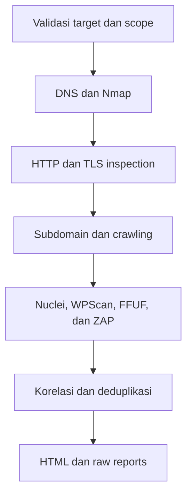

# HMT WebScan

**HMT WebScan** adalah Bash-based security assessment orchestrator untuk melakukan reconnaissance, pemeriksaan konfigurasi, discovery, vulnerability scanning, korelasi temuan, dan pembuatan laporan HTML secara otomatis.

Tool ini menggabungkan Nmap, DNS utilities, curl, OpenSSL, Nikto, ProjectDiscovery httpx, WhatWeb, testssl.sh, Subfinder, dnsx, Katana, FFUF, WPScan, Nuclei, dan OWASP ZAP dalam satu workflow.

> Gunakan hanya pada sistem milik Anda atau target yang secara eksplisit memberikan izin pengujian. Opsi `--authorized` adalah konfirmasi operator, bukan pengganti izin tertulis.

## Fitur utama

- Tiga profile pemindaian: `fast`, `standard`, dan `full`.
- Validasi URL, hostname, port, protokol, dan target private network.
- DNS reconnaissance untuk A, AAAA, MX, NS, TXT, CNAME, SOA, dan DNSSEC.
- Nmap service enumeration dan pemeriksaan CVE kandidat melalui NSE Vulners.
- Pemeriksaan HTTP response, security headers, metode OPTIONS, WAF, dan CDN.
- Analisis sertifikat serta dukungan TLS 1.2 dan TLS 1.3.
- Technology fingerprinting dengan httpx dan WhatWeb.
- Passive subdomain discovery dengan Subfinder dan DNS validation dengan dnsx.
- In-scope crawling dengan Katana.
- Optional content discovery menggunakan FFUF.
- WordPress vulnerability assessment menggunakan WPScan.
- Nuclei scanning untuk target utama dan attack surface hasil discovery.
- OWASP ZAP baseline/passive scan dan optional active scan.
- Korelasi, deduplikasi, confidence level, dan risk scoring.
- Report HTML, JSON, Markdown, scanner output, log, status, dan metadata versi tools.
- Scope guard untuk mencegah URL hasil crawling keluar dari domain target.

## Alur pemindaian



## Persyaratan

### Komponen utama

- Bash
- Python 3x
- curl
- Nmap
- OpenSSL
- `dig`
- GNU `timeout`

### Scanner tambahan

Tool tetap berjalan ketika beberapa scanner tambahan tidak tersedia. Cakupan report akan menyesuaikan dengan dependency yang ditemukan.

| Tool | Kegunaan | Status |
|---|---|---|
| Nikto | Web server checks | Opsional |
| ProjectDiscovery httpx | HTTP probing dan fingerprinting | Opsional |
| WhatWeb | Technology fingerprinting | Opsional |
| testssl.sh | TLS assessment | Opsional |
| Subfinder | Subdomain discovery | Opsional |
| dnsx | DNS validation | Opsional |
| Katana | Web crawling | Opsional |
| FFUF | Content discovery | Opsional dan opt-in |
| WPScan | WordPress assessment | Opsional |
| Nuclei | Template-based vulnerability scanning | Host atau Docker |
| OWASP ZAP | Passive/active web assessment | Docker |

> `httpx` yang diperlukan adalah versi dari ProjectDiscovery, bukan Python HTTPX CLI.

## Persiapan

Simpan script dengan nama `HMTwebscan.sh`, kemudian berikan permission eksekusi:

```bash
chmod +x HMTwebscan.sh
```

Periksa bantuan dan versi:

```bash
./HMTwebscan.sh --help
./HMTwebscan.sh --version
```

Periksa dependency utama:

```bash
command -v curl nmap openssl dig python3 timeout
```

Periksa scanner ProjectDiscovery:

```bash
httpx -version
subfinder -version
dnsx -version
katana -version
nuclei -version
```

Periksa Docker untuk OWASP ZAP dan fallback Nuclei:

```bash
docker version
docker info
```

## Penggunaan cepat

```bash
./HMTwebscan.sh [OPTIONS] <TARGET_URL>
```

Contoh audit standar:

```bash
./HMTwebscan.sh https://example.com
```

Target juga dapat diberikan melalui environment variable:

```bash
TARGET_URL=https://example.com ./HMTwebscan.sh
```

Selalu tulis protokol dan port yang benar. Contoh:

```bash
./HMTwebscan.sh http://example.com
./HMTwebscan.sh https://example.com
./HMTwebscan.sh http://example.com:8080
```

Jika protokol tidak ditulis, script menggunakan `https://` secara default.

## Scan profile

### Fast

Profile ringan untuk pemeriksaan awal. Nmap menggunakan version detection ringan dan tidak memindai seluruh port.

```bash
./HMTwebscan.sh --profile fast https://example.com
```

### Standard

Profile default untuk audit rutin dengan keseimbangan cakupan dan durasi.

```bash
./HMTwebscan.sh --profile standard https://example.com
```

Atau cukup:

```bash
./HMTwebscan.sh https://example.com
```

### Full

Profile terluas. Nmap memeriksa seluruh port TCP dan Nuclei melakukan scan tambahan terhadap URL serta host aktif yang ditemukan.

```bash
./HMTwebscan.sh --profile full https://example.com
```

`full` tidak otomatis mengaktifkan FFUF atau ZAP active scan. Keduanya tetap harus diaktifkan secara eksplisit.

## Opsi command line

| Opsi | Keterangan |
|---|---|
| `-h`, `--help` | Menampilkan bantuan. |
| `-V`, `--version` | Menampilkan versi. |
| `-p`, `--profile PROFILE` | Memilih `fast`, `standard`, atau `full`. |
| `--nuclei-profile PROFILE` | Memilih `fast`, `standard`, `web`, `wordpress`, atau `full`. |
| `--fuzz` | Mengaktifkan FFUF content discovery. |
| `--active-zap` | Mengaktifkan OWASP ZAP active scan. |
| `--authorized` | Mengonfirmasi bahwa operator memiliki izin pengujian. |
| `--allow-private` | Mengizinkan target private, localhost, atau internal. |
| `--allow-cross-host` | Mengizinkan redirect ke hostname berbeda. |
| `--wordlist FILE` | Menentukan wordlist FFUF. |
| `--timeout SECONDS` | Mengatur batas waktu scanner berat. |
| `--crawl-depth NUMBER` | Mengatur kedalaman crawling Katana. |

## Contoh penggunaan

### Full scan dengan ZAP tetap pasif

```bash
./HMTwebscan.sh --profile full https://example.com
```

### Full scan dengan FFUF

```bash
./HMTwebscan.sh \
  --profile full \
  --fuzz \
  --authorized \
  https://example.com
```

### Menggunakan wordlist FFUF khusus

```bash
./HMTwebscan.sh \
  --profile full \
  --fuzz \
  --authorized \
  --wordlist /usr/share/seclists/Discovery/Web-Content/common.txt \
  https://example.com
```

### OWASP ZAP active scan

Active scan mengirim payload pengujian ke endpoint dan parameter aplikasi. Gunakan pada staging atau lingkungan terkontrol yang telah diotorisasi.

```bash
./HMTwebscan.sh \
  --profile full \
  --active-zap \
  --authorized \
  https://staging.example.com
```

### Semua fitur opt-in

```bash
./HMTwebscan.sh \
  --profile full \
  --fuzz \
  --active-zap \
  --authorized \
  https://staging.example.com
```

### Target internal

```bash
./HMTwebscan.sh \
  --allow-private \
  http://10.10.10.2/WEB_VMS/LEVEL15/
```

Untuk target internal pada port khusus:

```bash
./HMTwebscan.sh \
  --profile full \
  --allow-private \
  http://10.10.10.2:8080/
```

### Mengubah timeout ZAP

```bash
ZAP_MAX_MINUTES=60 \
./HMTwebscan.sh \
  --profile full \
  --active-zap \
  --authorized \
  https://staging.example.com
```

## Environment variables

| Variable | Default | Fungsi |
|---|---:|---|
| `SCAN_PROFILE` | `standard` | Profile scan utama. |
| `NUCLEI_PROFILE` | `standard` | Profile template Nuclei. |
| `ENABLE_SUBDOMAIN` | `1` | Mengaktifkan Subfinder dan dnsx. |
| `ENABLE_CRAWL` | `1` | Mengaktifkan Katana. |
| `ENABLE_FUZZ` | `0` | Mengaktifkan FFUF. |
| `ENABLE_WPSCAN` | `1` | Mengaktifkan WPScan ketika WordPress terdeteksi. |
| `ENABLE_ACTIVE_ZAP` | `0` | Menggunakan ZAP full/active scan. |
| `I_HAVE_AUTHORIZATION` | `NO` | Harus `YES` untuk FFUF dan active ZAP. |
| `ALLOW_PRIVATE_TARGET` | `0` | Mengizinkan private/internal target. |
| `ALLOW_CROSS_HOST_REDIRECTS` | `0` | Mengizinkan redirect lintas hostname. |
| `FUZZ_WORDLIST` | kosong | Path wordlist FFUF. |
| `STEP_TIMEOUT` | `1800` | Timeout scanner berat dalam detik. |
| `HTTP_TIMEOUT` | `30` | Timeout request HTTP dalam detik. |
| `MAX_CRAWL_DEPTH` | `3` | Kedalaman Katana. |
| `MAX_CRAWL_URLS` | `5000` | Batas URL hasil crawl. |
| `MAX_SURFACE_TARGETS` | `750` | Batas target untuk surface Nuclei. |
| `ZAP_MAX_MINUTES` | `30` | Batas waktu ZAP dalam menit. |
| `NUCLEI_IMAGE` | `projectdiscovery/nuclei:latest` | Docker image Nuclei fallback. |
| `ZAP_IMAGE` | `ghcr.io/zaproxy/zaproxy:stable` | Docker image OWASP ZAP. |

Contoh penggunaan environment variable:

```bash
SCAN_PROFILE=full \
NUCLEI_PROFILE=web \
STEP_TIMEOUT=3600 \
./HMTwebscan.sh https://example.com
```

## Perbedaan Full, FFUF, dan ZAP

| Mode | Tujuan | Tingkat traffic |
|---|---|---|
| Full profile | Memperluas port scan, discovery, crawling, dan Nuclei attack surface | Sedang–tinggi |
| FFUF | Mencoba nama file/direktori dari wordlist | Sedang |
| ZAP Baseline | Passive scanning terhadap response aplikasi | Rendah–sedang |
| ZAP Active | Mengirim payload pengujian ke endpoint dan parameter | Tinggi |

## Output report

Setiap scan menghasilkan direktori:

```text
reports/<domain>_<timestamp>/
```

Struktur utamanya:

```text
reports/<domain>_<timestamp>/
├── report.html
├── SUMMARY.md
├── scan.log
├── correlation/
│   ├── findings.json
│   └── findings.txt
├── crawl/
├── dns/
├── fuzz/
├── http/
├── meta/
│   ├── steps.tsv
│   └── tool-versions.txt
├── nmap/
├── nuclei/
├── subdomains/
├── tls/
├── wpscan/
└── zap/
```

Buka dashboard utama:

```bash
firefox reports/<domain>_<timestamp>/report.html
```

File penting:

- `report.html`: dashboard hasil assessment.
- `SUMMARY.md`: ringkasan scan.
- `scan.log`: log seluruh proses.
- `correlation/findings.json`: temuan yang sudah dikorelasikan dan dideduplikasi.
- `meta/steps.tsv`: status, exit code, dan durasi setiap tahap.
- `meta/tool-versions.txt`: versi dependency yang digunakan.

## Memahami hasil

- `SUCCESS` berarti tahap selesai, tetapi tidak selalu berarti target merespons seluruh request.
- `NO DATA` berarti scanner tidak menghasilkan file data yang dapat digunakan.
- `FAILED` berarti scanner gagal atau dependency tidak tersedia.
- `TIMEOUT` berarti proses melewati batas waktu.
- `No results found` berarti tidak ada temuan pada request yang berhasil dilakukan; itu bukan bukti bahwa target sepenuhnya aman.
- Temuan Nmap Vulners memiliki confidence rendah sampai service dan versinya divalidasi secara manual.
- Hasil otomatis dapat mengandung false positive dan false negative.

## Troubleshooting

### Nuclei menampilkan `connection refused`

Pastikan protokol dan port target benar:

```bash
curl -I http://10.10.10.2/path/
curl -kI https://10.10.10.2/path/
```

Jika aplikasi hanya menggunakan HTTP, jangan menjalankan target sebagai HTTPS:

```bash
./HMTwebscan.sh --allow-private http://10.10.10.2/path/
```

### Target internal ditolak

Gunakan `--allow-private` hanya untuk target internal yang telah diotorisasi:

```bash
./HMTwebscan.sh --allow-private http://192.168.1.10
```

### Nuclei tidak terlihat pada dependency list

Nuclei dideteksi terpisah. Script menggunakan binary host terlebih dahulu, kemudian Docker sebagai fallback.

```bash
nuclei -version
docker run --rm projectdiscovery/nuclei:latest -version
```

### ZAP tidak terlihat sebagai binary lokal

Implementasi ZAP pada HMT WebScan menggunakan Docker:

```bash
docker version
docker run --rm ghcr.io/zaproxy/zaproxy:stable zap-baseline.py -h
```

### ZAP gagal mengakses target internal

Pastikan container Docker memiliki route menuju target dan target menggunakan protokol serta port yang benar. Uji koneksi dari container:

```bash
docker run --rm curlimages/curl:latest -I http://10.10.10.2/
```

### FFUF tidak berjalan

FFUF membutuhkan flag `--fuzz`, konfirmasi `--authorized`, dan wordlist yang tersedia:

```bash
./HMTwebscan.sh \
  --fuzz \
  --authorized \
  --wordlist /path/to/wordlist.txt \
  https://example.com
```

### ProjectDiscovery httpx tidak dikenali

Pastikan `httpx -h` menampilkan ProjectDiscovery. Binary Python dengan nama `httpx` tidak kompatibel dengan opsi yang digunakan script.

### Permission report ZAP

Pastikan direktori `reports/` dapat ditulis oleh user yang menjalankan script dan Docker dapat menulis ke volume `zap/`.

## Batasan

- Assessment bersifat eksternal dan unauthenticated secara default.
- Tidak menggantikan manual penetration test.
- Tidak menguji business logic secara menyeluruh.
- Aplikasi dengan autentikasi kompleks memerlukan konfigurasi/context tambahan.
- CDN atau reverse proxy dapat menyembunyikan service origin.
- Scanner dapat melewatkan kerentanan atau menghasilkan false positive.
- Hasil harus divalidasi sebelum remediation atau risk acceptance.

## Praktik penggunaan yang disarankan

1. Mulai dengan profile `fast` atau `standard`.
2. Pastikan URL, protokol, port, dan scope benar.
3. Jalankan profile `full` setelah baseline selesai.
4. Gunakan FFUF dan active ZAP pada staging bila memungkinkan.
5. Pantau CPU, memory, network, application log, dan alert selama active scan.
6. Validasi temuan critical/high secara manual.
7. Simpan report sebagai evidence dan bandingkan hasil setelah remediation.

## Disclaimer

HMT WebScan disediakan untuk security assessment yang sah dan terotorisasi. Pengguna bertanggung jawab memastikan izin, scope, waktu pengujian, perlindungan data, dan kepatuhan terhadap hukum serta kebijakan yang berlaku.

